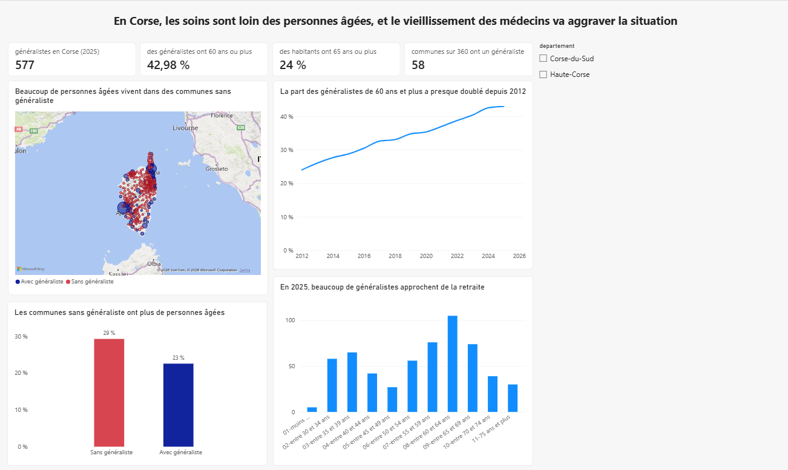
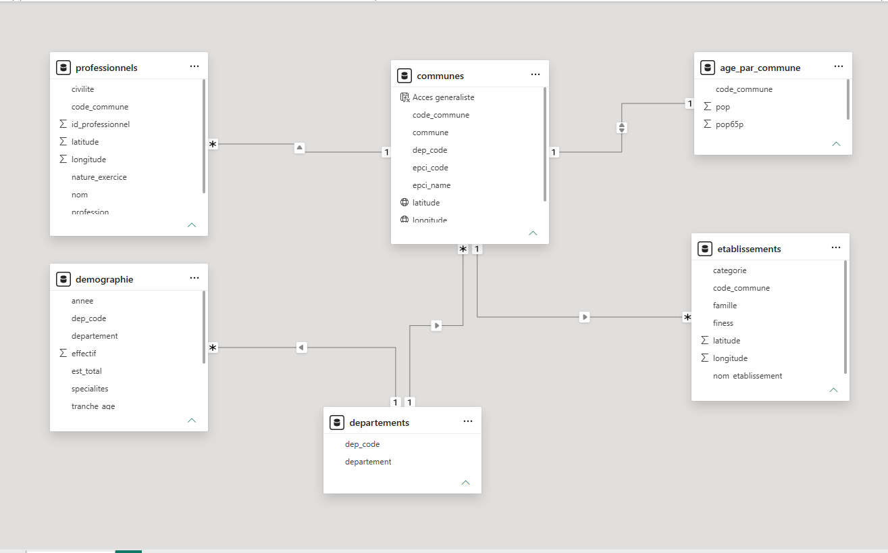
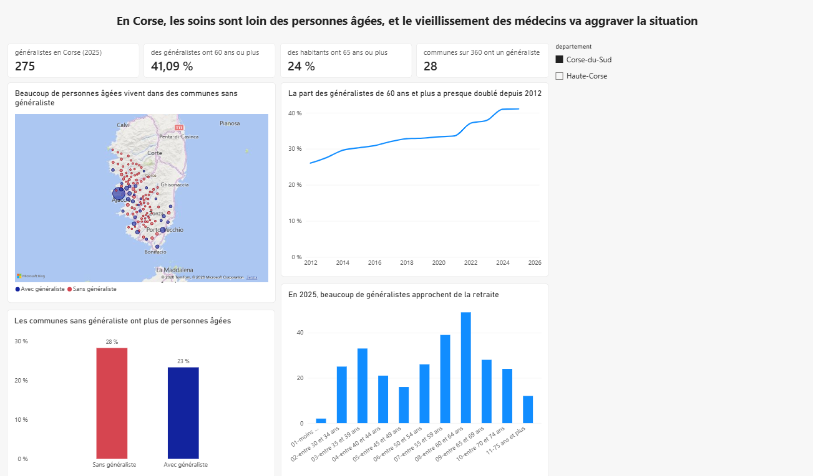

# Accès aux soins en Corse — Dashboard Power BI

> **En Corse, les soins sont loin des personnes âgées, et le vieillissement des médecins va aggraver la situation.**

Projet réalisé dans le cadre du Master Data Engineering (Université de Corse), module *Acquisition de données et visualisation*.
L'objectif : construire une base de données à partir de données publiques brutes, puis un dashboard interactif qui **défend un message** avec des graphiques.



---

## Les chiffres clés

| Indicateur | Valeur |
|---|---|
| Médecins généralistes en Corse (2025) | **577** |
| Part des généralistes de 60 ans et plus | **24 % en 2012 → 43 % en 2025** |
| Part des 65 ans et plus dans les communes **sans** généraliste | **29 %** |
| Part des 65 ans et plus dans les communes **avec** généraliste | **23 %** |

**Lecture :** les personnes âgées, qui ont le plus besoin de soins, vivent plus souvent dans des communes sans médecin, et près d'un généraliste sur deux approche de la retraite.

---

## Démarche

```
Données brutes (Excel / CSV)
        │
        ▼  nettoyage automatisé — Python / pandas
Données propres (CSV)
        │
        ▼  import + contrôle des types — Power Query
Modèle de données — Power BI (schéma en flocon)
        │
        ▼  mesures DAX
Dashboard interactif — Power BI
```

### 1. Nettoyage des données (`nettoyage.py`)

Le script corrige automatiquement les problèmes détectés dans les 5 fichiers sources. Il se relance en quelques secondes si les données sont mises à jour.

| Fichier | Problème | Correction |
|---|---|---|
| Démographie | Faute de frappe (« Othoponistes ») | Libellé unifié |
| Démographie | Valeurs « ND » : colonne lue comme du texte | Cases vides, colonne numérique |
| Démographie | Une colonne par année (format large) | Format long : `annee` + `effectif` |
| Démographie | Ligne de total mêlée aux tranches d'âge | Colonne `est_total` (évite les doubles comptes) |
| Démographie | Code département différent des autres fichiers | Colonne `dep_code` = 2A / 2B |
| Carreaux INSEE | Carreaux à cheval sur 2 communes : codes collés (`2A008,2A228`), 553 codes au lieu de 360 | Un seul code par carreau, puis somme par commune |
| Professionnels | 26 colonnes, pas d'identifiant | 8 colonnes utiles + `id_professionnel` |
| Établissements | ~80 catégories, illisibles dans un graphique | Regroupées en 6 familles |
| Tous | Coordonnées GPS dans une seule colonne texte | Séparées en `latitude` / `longitude` |

### 2. Modèle de données



- **`communes`** est la table centrale, reliée aux professionnels, aux établissements et à la population âgée par `code_commune`.
- **`departements`** (2 lignes) relie la démographie médicale, disponible seulement par département. Elle évite une relation « plusieurs à plusieurs ».
- Les filtres vont dans un seul sens (du côté « 1 » vers le côté « plusieurs ») : un clic sur une commune n'affiche jamais les chiffres d'un département comme s'ils étaient ceux de la commune.

Le dictionnaire de données complet est dans [`docs/base_donnees.pdf`](docs/base_donnees.pdf).

### 3. Mesures DAX

```dax
Generalistes =
CALCULATE(
    SUM(demographie[effectif]),
    demographie[specialites] = "01-Médecine générale",
    demographie[est_total] = TRUE()
)

% Generalistes 60+ = DIVIDE([Generalistes 60+], [Generalistes])

% Habitants 65+ = DIVIDE(SUM(age_par_commune[pop65p]), SUM(age_par_commune[pop]))

Communes avec generaliste =
CALCULATE(
    DISTINCTCOUNT(professionnels[code_commune]),
    professionnels[profession] = "Médecin généraliste"
)
```

Une colonne calculée `Acces generaliste` classe chaque commune en « Avec généraliste » / « Sans généraliste » ; elle sert à colorer la carte et le graphique de comparaison.

### 4. Dashboard

| Graphique | Ce qu'il prouve |
|---|---|
| Carte de la Corse (bulles = personnes de 65 ans et plus, couleur = présence d'un généraliste) | Les personnes âgées de l'intérieur vivent loin des médecins |
| Barres « avec / sans généraliste » | Les communes sans médecin ont une population plus âgée (29 % contre 23 %) |
| Courbe 2012 → 2025 | La part des généralistes de 60 ans et plus a presque doublé |
| Répartition par âge en 2025 | Beaucoup de départs à la retraite à venir |
| Filtre département | Toute la page passe en Corse-du-Sud ou Haute-Corse |



---

## Limites des données

- **Liste des professionnels incomplète** (229 généralistes listés contre 577 recensés) : elle sert à **localiser** l'offre, pas à la compter. Les effectifs viennent des statistiques démographiques.
- **Secret statistique INSEE** : les carreaux peu peuplés ont des valeurs arrondies. L'analyse se fait par commune, où l'écart reste inférieur à 1 %.
- **Démographie médicale disponible par département seulement**, pas par commune.

---

## Outils

- **Python 3** — pandas, openpyxl (nettoyage)
- **Power BI Desktop** — Power Query, modélisation, DAX, visualisation
- **VS Code** — édition du code
- **LaTeX** — documentation de la base

## Lancer le nettoyage

Les données sources ne sont pas publiées dans ce dépôt (données fournies dans le cadre du cours ; le fichier des professionnels contient des données nominatives).

```bash
pip install -r requirements.txt
# placer les fichiers sources dans data/raw/
python nettoyage.py
# les fichiers propres sont créés dans data/clean/
```

Puis ouvrir `dashboard_acces_soins.pbix` dans Power BI Desktop et cliquer sur **Actualiser**.

---

**Auteur :** M'hand Amrane — Master Data Engineering, Université de Corse
[GitHub](https://github.com/MhandAMRANE)